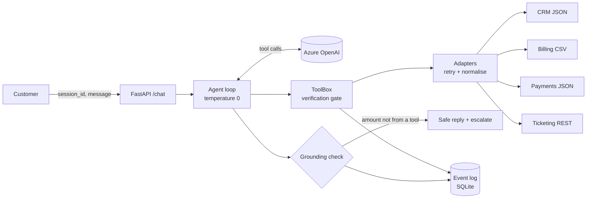

# billbridge

[](https://github.com/tariqkistan/billbridge/actions/workflows/ci.yml)
[](https://www.python.org/)
[](LICENSE)

An AI agent that resolves telecom bill disputes against a deliberately messy simulated legacy backend.

A customer asks why their bill went up or whether a payment landed. The agent verifies who they are, pulls data from unreliable legacy systems, explains the charges using only facts the systems returned, and hands off to a human with full context when it cannot resolve the issue.

> **Pilot rehearsal, not a customer deployment.** The client, Karoo Mobile, is invented. Every customer-side system (CRM, billing, payments, ticketing) is a simulator in [`legacy_sim/`](legacy_sim/app.py), and all data is synthetic.

## Architecture



What happens on each message:

1. `/chat` loads the session for `session_id`.
2. The agent loop sends the conversation and four tool schemas to the model.
3. When the model asks for a tool, **our code** runs it. Account tools refuse unless the session is verified.
4. Adapters call the legacy systems with retries and convert their output to clean models (money as integer cents).
5. Tool results go back to the model, which writes the reply.
6. The grounding check compares every rand amount in the reply with the amounts tools returned. A mismatch swaps in a safe message and escalates.
7. Tool calls, escalations and grounding failures go to the event log, with no customer text.

## The mess the adapters handle

| System | The mess | What the adapter does |
| --- | --- | --- |
| CRM (JSON) | Upper-case legacy keys, padded names, duplicate INACTIVE record, `DD/MM/YYYY` dates | Picks the single ACTIVE record, cleans fields; two ACTIVE records is a data-quality error |
| Billing (CSV) | `;` delimiter, `R312,50` / `-R50,00`, period `202610`, category codes | Parses money to cents, derives period dates, maps codes |
| Payments (JSON) | Amounts as strings, single-letter status | Normalises; unknown status raises |
| Tickets (REST) | Duplicates on retry without `Idempotency-Key` | Stable key per escalation, one ticket per session |

Fault modes on the simulator: `none`, `crm_down` (CRM always 503), `flaky` (30% of calls 503, seeded).

Errors fall into three classes, and the class decides what happens: **transient** errors are retried with backoff, **permanent** ones fail fast, and **data-quality** errors escalate instead of guessing.

## Safety is enforced in code

| Layer | Where | What holds even if the prompt fails |
| --- | --- | --- |
| Verification gate | [`tools.py`](src/billbridge/tools.py) | Account tools return `not_verified` until `verify_identity` succeeds |
| No account-id parameter | [`tools.py`](src/billbridge/tools.py) | "Show me account A-0411" has nothing to aim at |
| Uniform failure response | [`tools.py`](src/billbridge/tools.py) | Unknown number and wrong details look identical; lock + escalate after 3 failures |
| Arithmetic in code | `_changes_by_category` | The model narrates differences it was handed |
| Grounding check | [`agent.py`](src/billbridge/agent.py) | Any rand amount no tool returned → safe reply + escalation |
| Step limit | [`agent.py`](src/billbridge/agent.py) | A model that never stops calling tools is escalated |
| No PII in logs | [`events.py`](src/billbridge/events.py) | Only tool names, outcomes, reasons and latencies are logged |

## Quickstart

```bash
python -m venv .venv && source .venv/bin/activate
pip install -e '.[dev]'
cp .env.example .env              # add AZURE_OPENAI_* (or OPENAI_API_KEY)

pytest -m "not eval"              # deterministic tests, no key needed
python -m scripts.chat            # talk to the agent in the terminal
python -m scripts.run_scenarios   # scenario suite against the real model
python -m scripts.report          # metrics from the event log
```

Test customer: mobile `0821234567`, ID last 4 `1083`, date of birth `1985-03-12`.

The story in the data: October's invoice is **R910,50** against **R598,00** in September, and the whole **R312,50** difference is a roaming charge. A R910,50 payment dated 5 November is still pending.

Run as services:

```bash
uvicorn legacy_sim.app:app --port 9000 &
uvicorn billbridge.api:app --port 8000
curl -X POST localhost:8000/chat -H 'content-type: application/json' \
  -d '{"session_id": "demo", "message": "Why is my bill higher? 0821234567, 1083, 1985-03-12"}'
# or: docker compose up --build
```

## Testing and the eval gate

| Layer | What it proves | Runs |
| --- | --- | --- |
| [`tests/`](tests/) with a scripted fake model | Adapters, retries, the gate, lockout, idempotency, grounding, loop limit, API, metrics | Every push and PR, no key needed |
| [`scenarios/scenarios.yaml`](scenarios/scenarios.yaml) against a real model | The prompt + model behave: answers, leaks, injections, outages, escalation | CI on `main` and manual dispatch when a key secret is set; fails below 90% |

To enable the scenario gate in CI, add repository secrets `AZURE_OPENAI_ENDPOINT` and `AZURE_OPENAI_KEY` (or `OPENAI_API_KEY`), plus the variable `AZURE_OPENAI_DEPLOYMENT` if it isn't `gpt-4o`.

## Monitoring

`python -m scripts.report` reads the event log and prints sessions, containment rate, escalation reasons, grounding failures, and per-tool calls, error rate and p50/p95 latency. Containment is not resolution, so the [runbook](docs/discovery/04_handover_runbook.md) pairs it with re-contact rate.

## Scoping-to-handover paper trail

- [Scoping note](docs/discovery/01_scoping.md): problem, scope, success metrics
- [Assumptions log](docs/discovery/02_assumptions_log.md): what discovery must confirm
- [Pilot plan](docs/discovery/03_pilot_plan.md): six weeks from discovery to handover
- [Handover runbook](docs/discovery/04_handover_runbook.md): operations, alerts, incidents
- [Design decisions](docs/design_decisions.md): trade-offs and alternatives considered

## Known limitations

- Sessions are in memory, so they are lost on restart and limited to one instance. Production would use Redis with expiry.
- `/chat` has no auth of its own; it is meant to sit behind a channel platform.
- The grounding check only sees amounts written like `R312,50`. "Roughly R900" slips through. It is a safety net, not a proof.
- `except TypeError` for bad tool arguments can hide handler bugs. Per-tool Pydantic validation would be stronger.
- Simulator fault modes are global state, so scenarios run sequentially.

## Project layout

```text
legacy_sim/          the fake enterprise backend (not part of the product)
src/billbridge/      config, logger, errors, models, resilient, adapters,
                     session, tools, agent, events, llm, api
scenarios/           scenario suite (YAML)
scripts/             run_scenarios, report, chat
tests/               deterministic tests with a scripted model
docs/                discovery pack and design decisions
```
